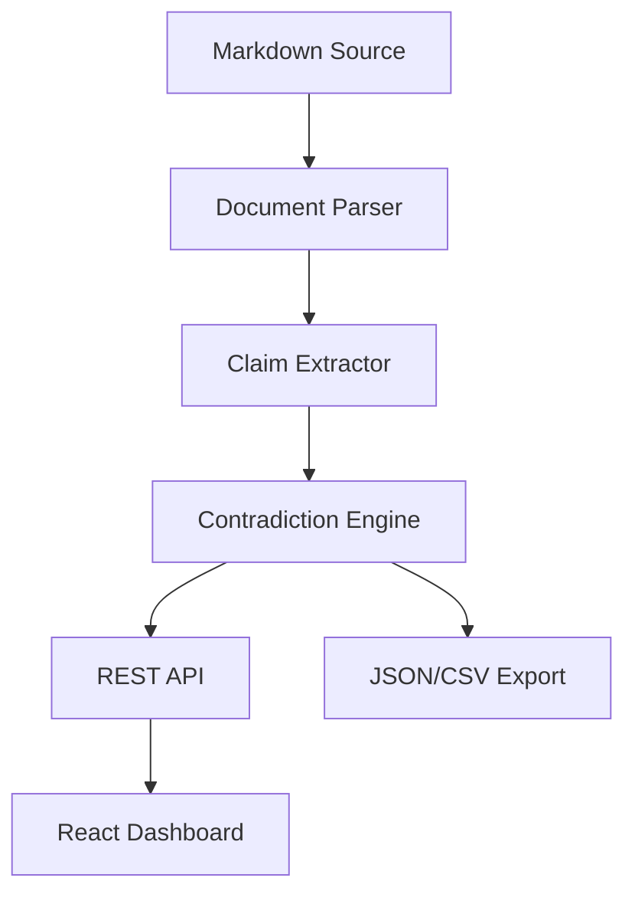

# Axiom Station - AI Engineering Documentation Contradiction Detector

> Work in progress. This checkpoint may be incomplete or fail tests. See PLAN.md and STATUS.md before use.


## Project Overview

**Axiom Station** is an AI/ML developer tool that automatically detects factual contradictions and self-inconsistencies in technical documentation, specifically designed for the "AI Engineering from Scratch" curriculum review. It parses structured markdown documents, extracts claims from different sections (hooks, bodies, tables, exercises), and cross-references them to find contradictions.

**Author**: Ryan Vo (ryandtvo@gmail.com) | AI & Machine Learning

## Architecture



## Current Status

- [x] Project skeleton initialized
- [ ] Document parser for structured markdown
- [ ] Claim extraction from hooks/tables/bodies/exercises
- [ ] Contradiction detection engine
- [ ] FastAPI backend with tests
- [ ] React + TypeScript frontend
- [ ] Docker + CI/CD
- [ ] Keycloak OIDC authentication

## Workflows

1. **Document Analysis**: Upload markdown curriculum → get structured contradiction report
2. **Interactive Review**: Browse contradictions in dashboard with source context
3. **Export & Track**: Export findings for upstream PR creation

## Tech Stack

- **Backend**: FastAPI, Python 3.12, SQLite, pytest, httpx
- **Frontend**: React 18, TypeScript, Vite, Vitest
- **Auth**: Keycloak OIDC with PKCE
- **Deployment**: Docker Compose

## Quick Start

```bash
# Backend
python3 -m venv .venv
.venv/bin/pip install -r backend/requirements.txt
.venv/bin/python -m pytest backend/tests

# Frontend
cd frontend
npm install
npm run build
npm test
```

## License

MIT © Ryan Vo <ryandtvo@gmail.com>